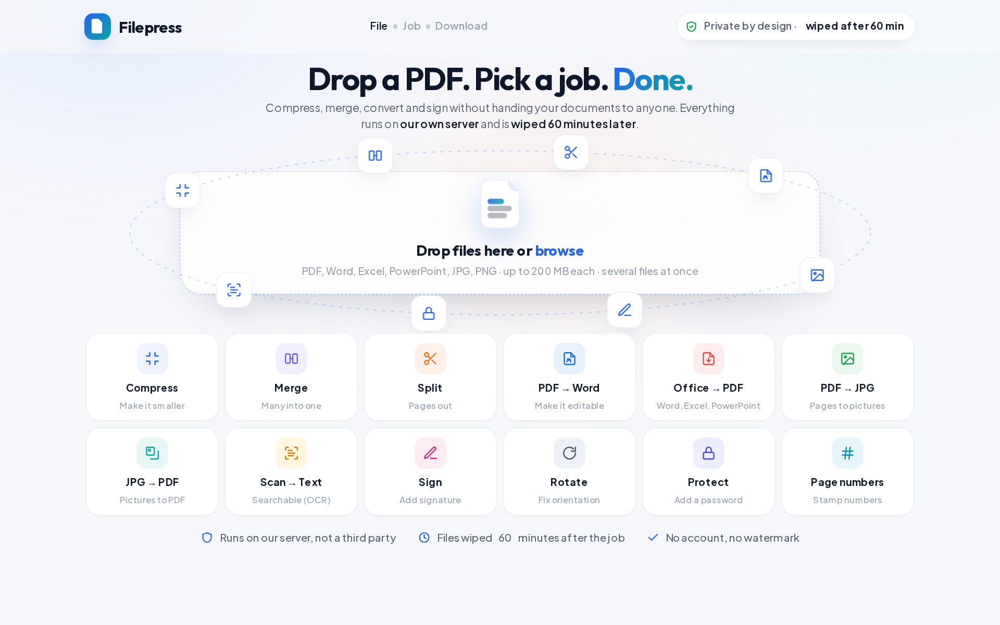
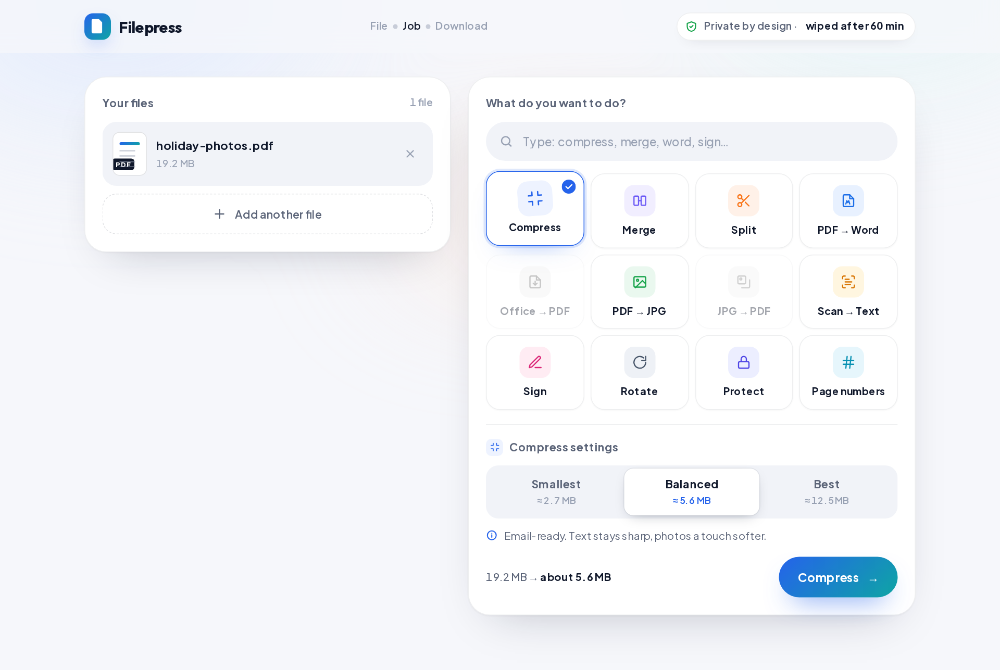
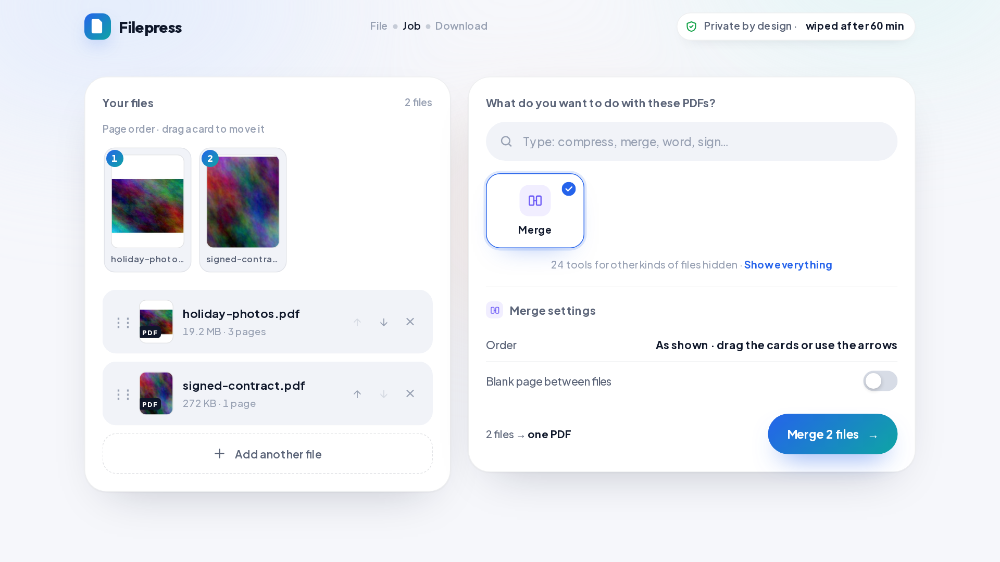
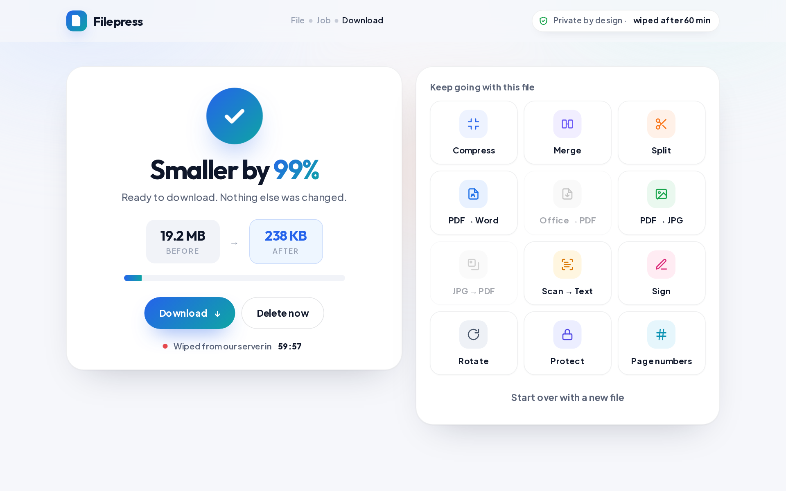
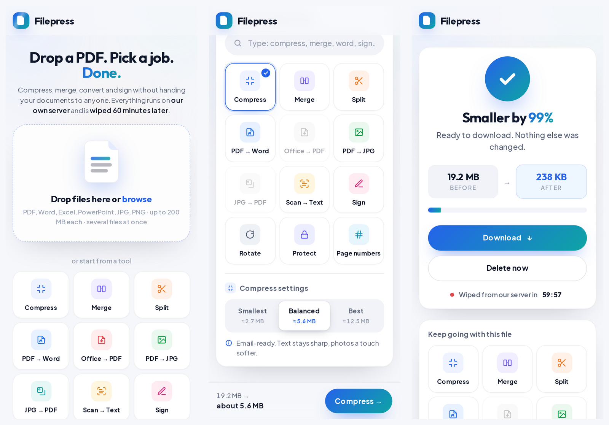

# Filepress

**Private PDF and picture tools on your own server.** Drop a file, pick a job, download the result.
Everything is processed inside your container and wiped an hour later. No third party ever sees a page or a photo.

Think of the popular online PDF and image sites, but running on a machine you control, with no accounts, no
watermarks and nothing kept. Filepress recognises what you dropped (a PDF, a picture, or a Word/Excel/PowerPoint
file) and shows only the tools that fit it.



## What it does

### PDF tools

| Tool | What you get | Engine underneath |
|---|---|---|
| **Compress** | A much smaller PDF, three quality levels, text stays sharp | Ghostscript |
| **Merge** | Several PDFs joined in your order, optional blank divider page | qpdf |
| **Split** | Chosen pages as one PDF, or one file per page / per N pages (ZIP) | qpdf |
| **PDF → Word** | An editable .docx with flowing paragraphs; fill-in blanks and word spacing kept | pdf2docx + `pdf-word.py` |
| **Office → PDF** | Word, Excel, PowerPoint, OpenDocument, RTF, TXT to PDF | LibreOffice |
| **PDF → JPG** | One picture per page, three sharpness levels | Poppler |
| **JPG → PDF** | Photos and scans into one PDF, picture-size or A4/Letter pages | img2pdf |
| **Scan → Text** | A searchable PDF: invisible text layer over the scan (English, Telugu) | OCRmyPDF + Tesseract |
| **Sign** | Typed or hand-drawn signature placed on chosen pages and corner | pdf-lib |
| **Rotate** | Pages turned 90° either way or upside down | qpdf |
| **Protect** | 256-bit password lock | qpdf |
| **Page numbers** | Numbers stamped in the style and position you choose | pdf-lib |

A Word, Excel or PowerPoint file dropped on any PDF tool is turned into a PDF first, automatically, so you can
compress, merge or sign an Office document in one go.

### Picture tools

| Tool | What you get | Engine underneath |
|---|---|---|
| **Compress picture** | Smaller JPG/PNG, three levels, camera metadata removed | ImageMagick |
| **Resize** | By percent or to a pixel box, proportions kept or exact | ImageMagick |
| **Crop** | Cut to a shape (1:1, 4:3, 16:9…) from a chosen side, or trim plain borders | ImageMagick |
| **Convert to JPG** | PNG, GIF, WEBP, HEIC, TIFF, BMP to JPG | ImageMagick |
| **Convert from JPG** | JPG to PNG, WEBP, GIF, BMP or TIFF | ImageMagick |
| **Rotate picture** | Turn 90°/180°, mirror or flip, many at once | ImageMagick |
| **Upscale** | 2×, 3× or 4× enlargement with a light sharpen (plain resampling, not AI) | ImageMagick |
| **Watermark** | Your text stamped in a corner, the middle, or tiled across the picture | ImageMagick |
| **Meme** | Top and bottom captions in classic white-on-black-outline capitals | ImageMagick |
| **Blur faces** | Faces found and blurred on your server with a small open-source model | OpenCV + YuNet |

Pictures can be JPG, PNG, GIF, WEBP, BMP, TIFF or HEIC. Phone photos keep their correct orientation, and every
output has the camera metadata (including GPS position) removed. Three more picture tools (photo editor, remove
background, web page → picture) are shown as "Soon" and not built yet.

Results can be chained: compress, then sign, then protect, without uploading again.

## How it feels

The start page has two tabs, PDF tools and picture tools, or you simply drop a file. Filepress reads the file
type and asks "What do you want to do with this PDF?" (or picture, or Office file), showing only the tools that
fit; a link reveals the rest. Pick a job and its settings appear in place, with the expected result size shown
right on the buttons. Every file shows a real preview, rendered in your browser before anything is uploaded.



When a job joins several files, a page-order strip appears. Drag a card to move it, on mouse or touch.



A ring fills while the server works. The result page then shows before and after sizes and one Download
button with a five-second ring: the file downloads by itself, or straight away when you click. Next to it a
"Work on another document" box starts a fresh job, the tools that fit the result let you keep going with it,
and a quiet line shows the countdown to the automatic wipe with a "Delete it now" link.



It works the same on a phone: three tools per row, the action button pinned to the bottom, and a
"Work on another document" button right under Download.



## Why it is private

* Files are processed on **your** server. The browser only talks to your container.
* Every job runs in its own temporary folder and is **wiped 60 minutes** after it finishes (configurable).
  "Delete now" wipes it immediately.
* Each browser gets a signed cookie and can only see its **own** jobs. A link to a result is useless to anyone else.
* An optional **access code** locks the whole site, so only people you tell can use it.
* The converters run as a **separate, unprivileged Linux user** with memory, CPU and time limits, so a hostile
  file cannot read the server's secrets or take the site down.
* Picture outputs have EXIF metadata stripped, so a shared photo no longer carries the place it was taken.
  Blur faces runs a small open-source face model on your server; nothing is sent to any outside service.
* No analytics, no outside fonts or scripts, strict Content Security Policy, nothing logged about your files.

Details in [docs/DESIGN.md](docs/DESIGN.md).

## Host it yourself

Filepress is one Docker image. Anything that runs Docker can run it. The image is about 1.3 GB because it
carries LibreOffice and the OCR engine; give the container **2 GB of RAM or more**.

### Option A: Railway (no server to manage)

1. Fork this repository (or use it directly), then in Railway choose **New Project → Deploy from GitHub repo**
   and pick it. Railway detects the `Dockerfile` by itself.
2. In **Variables** add:
   * `ACCESS_CODE` – the code people must enter, at least 8 characters. Leave empty for an open site.
   * `SESSION_SECRET` – any random text of at least 32 characters (keeps people signed in across restarts).
3. **Settings → Networking → Generate Domain**. Open the URL. Done.

The first build takes a few minutes. Health check path: `/healthz`.

### Option B: Your own server with Docker Compose

```bash
git clone https://github.com/venuweb7/filepress.git
cd filepress
cp .env.example .env        # set ACCESS_CODE and SESSION_SECRET
docker compose up -d --build
```

Filepress now answers on port 8080. Put a reverse proxy with HTTPS in front of it. With
[Caddy](https://caddyserver.com) that is a two-line file and certificates are automatic:

```
files.example.com {
    reverse_proxy 127.0.0.1:8080
}
```

The compose file keeps job folders on a RAM disk (`tmpfs`), so uploads never touch your disk at all.
Raise `size=2g` if you expect many large files at once.

### Option C: Plain Docker

```bash
docker build -t filepress .
docker run -d --name filepress -p 8080:8080 \
  -e ACCESS_CODE=choose-a-code -e SESSION_SECRET=a-long-random-string \
  --memory 4g --restart unless-stopped filepress
```

### Settings

All settings are environment variables. Defaults are sensible; the two secrets are the only ones you
normally touch.

| Variable | Default | Meaning |
|---|---|---|
| `ACCESS_CODE` | empty | Shared code to unlock the site. Empty = open. Minimum 8 characters. |
| `SESSION_SECRET` | random per start | Signs the session cookie. Minimum 32 characters if set. |
| `APP_NAME` | `Filepress` | Name shown in the interface. |
| `RETENTION_MIN` | `60` | Minutes a result is kept after the job ends. |
| `MAX_FILE_MB` | `200` | Largest single upload. |
| `MAX_FILES` | `20` | Files per job. |
| `MAX_REQUEST_MB` | `400` | Whole upload per job. |
| `MAX_PAGES` | `500` | Page limit for page-by-page tools. |
| `CONCURRENCY` | `2` | Jobs processed at the same time. |
| `TOOL_TIMEOUT_SEC` / `HEAVY_TIMEOUT_SEC` | `240` / `480` | Time limits per job (heavy = Office, OCR, PDF → Word). |
| `TOOL_MEM_MB` | `2048` | Memory cap per converter. |
| `PORT` | `8080` | Listening port. |

## Develop

Needs Node 22+ and the engines listed in the Dockerfile (`ghostscript qpdf poppler-utils libreoffice-writer
libreoffice-calc libreoffice-impress ocrmypdf tesseract-ocr-eng tesseract-ocr-tel img2pdf imagemagick
libmagickcore-6.q16-6-extra` plus `pip install pdf2docx opencv-python-headless`).

```bash
npm install
npm start                            # http://localhost:8080
npm test                             # end-to-end: every tool through the HTTP API with real files
python3 -I test/e2e_browser.py       # real-browser run with Playwright
python3 -I docs/make_screenshots.py  # regenerate the README pictures
```

## Known limits

* PDF → Word quality depends on the PDF; scans need **Scan → Text** first.
* Typed signatures use a Latin handwriting font; other scripts can be drawn instead.
* Signatures and page numbers go to a chosen corner; free placement on a page preview is on the list.
* OCR ships with English and Telugu; add more `tesseract-ocr-<lang>` packages to the Dockerfile for other languages.
* Upscale is plain enlargement with sharpening, not an AI model; it will not invent detail.
* Blur faces can miss faces seen from the side or very small ones. Check the result before sharing it.
* Crop works by shape (1:1, 16:9…) and side; a free-hand crop editor is not built yet. HEIC inputs come back as JPG.
* Pictures are limited to 60 megapixels and 500 frames; animated GIFs are flattened to their first frame.

## Licence

MIT for this code (`LICENSE`). Bundled fonts are under the SIL Open Font License, the YuNet face model is MIT,
and the engines keep their own licences; see `licenses/README.md`.
